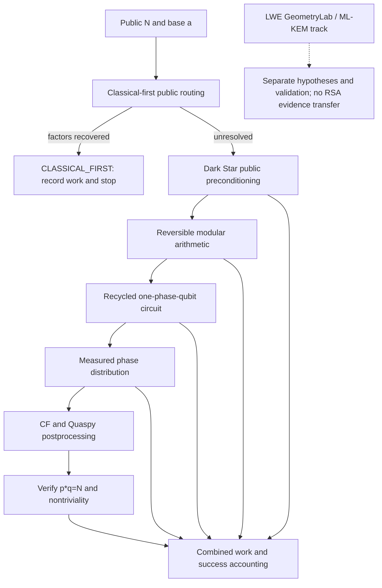

# Quantum factoring integration map and continuity protocol

**Research lead:** Chase Lunsford / CaMaLabs  
**Updated:** 2026-10-30  
**Scope:** RecycledQubitRegisters, Dark Star, Quaspy, and relevant LWE experiments (separate cryptosystem track).

## Objective and invariant

Build an independently reproducible, **public-input-only** chain from candidate modulus N and base a through classical preparation, quantum modular arithmetic and phase generation, measurement, classical recovery, and independent factor verification. Optimize **total expected cost per verified factor**, not one attractive intermediate metric.

**Never replace an old technique with a new one without an explicit paired comparison.** Keep original algorithms, their results, known failures, and provenance visible. A theoretical or exact-ideal success is not a real-device success or an RSA break.

## Dependency graph

## Method registry (do not silently drop)

| ID | Method | Role | State / evidence | Retention rule |
|---|---|---|---|---|
| DS-PTP | Periodic Table of Primes / primorial residue tables | public modular filtering | Historical Dark Star origin; baseline and setup-cost accounting required | Preserve original code and compare |
| DS-FERMAT | Original composite-specific Fermat midpoint/residue pruning | classical close-factor candidate rejection | N26 restoration audit: no false pruning, but no practical universal end-to-end speedup | Keep as opt-in specialized branch |
| DS-QR | Quadratic-residue midpoint sieve | cheaper public pruning | N26/N27/N34 exploration; profile setup, checks and wall time | Compare to unpruned and wheel baselines |
| DS-RHO | Public-cost router with bounded Brent rho and wheel fallback | honest classical-first competition | `integrations/darkstar_hybrid/darkstar_public_cost_router.py` | Always count full fallback work separately |
| DS-U1 | Skip controlled modular multipliers equal to 1, using public powers | gate reduction | Exact source-level identity pruning; N27 cohort zero gain | Never claim hidden-order shortcut |
| QRR-ARITH | Frozen modular arithmetic and scratch recycling | qubit/instruction resources | A21 provenance: 32-to-23 qubits, instruction-identical specified comparison | Hold circuit semantics fixed during comparisons |
| QRR-QPE | True recycled phase feedforward | phase output | A23 exact N35 branch-vs-independent model difference <= ~1.4e-15 | Need full gate-level/real-shot fidelity checks |
| POST-CF | Continued fractions | classical factor recovery | A23 exact N35 8-bit 29.23% for base 2; 50% for base 8 | Retain as cheap baseline |
| POST-QUASPY | Ekerå/Quaspy order postprocessing | stronger recovery for low-resolution phase | A23 ideal N35 8-bit ~100% for both bases; higher modular-exponentiation work | Retain; report work and timeout policy |
| LWE-ORIG | Fourier/NTT, geometric, noise and recursive pruning techniques | ML-KEM/LWE experiments | Separate LWE_GeometryLab research | Preserve and compare against lattice methods |
| LWE-LATTICE | Babai/LLL/BKZ/rotation comparisons | ML-KEM/LWE control | Separate track | Never mix recovery claims with RSA |

Statuses in this registry are **evidence labels**, not a claim that all modules are wired into a single executable. Add exact commit/receipt links as each gate is tested.

## Milestones / gates

- **A21**: PASS_WITH_INTEGRATION_GAPS. Provenance connection, not full end-to-end validation.
- **A22**: Matched N35 synthetic phase samplers and CF/Quaspy; the sampler used known order internally.
- **A23**: PASS_EXACT_IDEAL_BRIDGE from user execution. N=35, a=2/8, phase bits=4/6/8. Full exact ideal branch probabilities matched independent spectral calculations. Quaspy 8-bit success ~1.0. Zero QPU jobs. **Not a full gate-level or hardware result.**
- **A24**: Public-first N35 audit in `integrations/darkstar_hybrid/qrr_a24_n35_public_first_gate.py`; this catches the fact that N=35 is trivially factorable by public small-prime screening. It must not be sold as quantum advantage.
- **Gate G1**: Produce identical N/base/phase cohorts for classical-first, recycled circuit, CF, and Quaspy.
- **Gate G2**: On unresolved public-first cases, connect live circuit-generated phase outcomes and compare to independently derived distribution; distinguish ideal statevector/dynamic simulation and real QPU.
- **Gate G3**: Connect *public-only* Dark Star preconditioners to actual circuit construction or certified semantic no-ops; prevent factors/order leaking into routing.
- **Gate G4**: Report expected total classical modular operations, quantum logical gates, physical qubits, circuit depth, resets, mid-circuit feedforward, repetitions, real shots, fidelity and wall time. Keep measurements from different environments incomparable unless normalized.
- **Gate G5**: Repeat on preregistered larger and less-special moduli including deliberately non-close semiprimes; compare against competent classical algorithms and Shor baselines.
- **Gate G6**: Real-device experiment only if free-resource limits and stated fidelity gates pass; otherwise mark NO-GO without spending funds.

## Fixed experiment record schema

Every run must report: experiment ID, date, commit/branch, preregistered input cohort and SHA, N/base/phase bits, public preprocessing stages, selected/disabled methods and **reasons**, seed and hidden-truth provenance, circuit variant, simulator/backend, number of jobs/shots, distribution checks, postprocessors and timeouts, per-stage counts/cost, success/failure for *every* input, baselines, known limitations, next gate. Include raw machine-readable output. A failed experiment is data, not a reason to erase a method.

## Self-instructions for any future assistant

1. Read this map, latest RESEARCH_LOG and A21–A24 receipts **before** changing the pipeline.
2. Check `main` and open branches/PRs. Never assume a conversational claim has been committed or tested.
3. Enumerate methods using the registry above. Mark each **active**, **control**, **conditional**, **deferred**, or **falsified** with supporting evidence. Do not silently abandon earlier DS-PTP, DS-FERMAT, or DS-QR.
4. Make **one clearly scoped hypothesis per experiment**. Use paired frozen-cohort tests with identical inputs, fixed budgets and baselines.
5. Distinguish mathematical proofs, ideal simulations, executed circuit simulations, offline hardware compilation, actual quantum shots, and external cryptanalytic claims.
6. Guard against non-public information, synthetic-known-order leakage, classical fallback counted as quantum success, and tuning on holdouts.
7. Run available tests; if GitHub-only, commit source and explicitly mark runtime results **pending**. Do not invent execution or GitHub Actions success.
8. Commit new evidence on a branch and propose review before rewriting `main`. Update this map + research log with measured outcomes, **not only wins**.
9. Reject a speedup claim unless total expected verified-recovery cost beats a relevant baseline, including precomputation and retries.
10. Keep ML-KEM/LWE and RSA factoring as scientifically separate tracks. Transfer algorithms only via a stated mathematical reduction and fresh validation.

## Immediate next integration

A24 public-first gate -> A25 same-cohort `N` factoring route + Quaspy work-accounting adapter with unresolved cases -> A26 actual dynamic circuit distribution and noise sweep -> A27 Dark Star pruning ablation against the same frozen cases. Preserve A23 as the ideal-model component validation, and keep real-hardware gate NO-GO until quantitative criteria support it.
